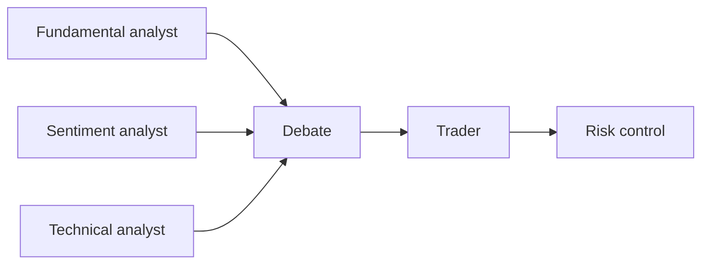
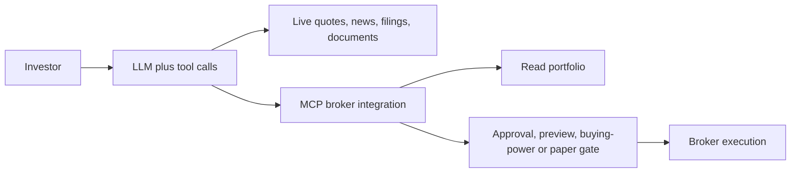

# Report: TASK-12 AI agents for personal investing

Research: research · web

> [!IMPORTANT]
> **Use AI for research; sustained market outperformance is unproven.** (medium)
>
> - Portfolio analysis, screening and earnings/news summaries are usable.
> - Real-money agents launched in 2026 with execution safeguards.
> - Unaudited stock-picking returns remain marketing claims.
>
> Next step: start with Ask IBKR and an assistant linked through Parqet.
>
> Risk: confident financial errors can cause real-money losses.

## Comparison table

- Synthesis: readiness judgments inherited from the original report.

| Product | Role | Readiness |
|---|---|---|
| Robinhood Agentic Trading | Broker execution | ⚠️ New; isolated subaccounts |
| Scalable Capital | Broker execution | ⚠️ New; explicit approval |
| Public AI agents | Broker execution | ⚠️ New; standing instructions |
| moomoo API Skills | Broker execution | ⚠️ New; paper trading by default |
| Ask IBKR | Portfolio research | ✅ Mature; free with account |
| eToro Tori | Broker assistant | ⚠️ New; indexed evidence |
| Alpaca | Broker infrastructure | ⚠️ Ongoing; partner infrastructure |
| Danelfin | Quantitative screening | ✅ Mature; Plus $12–25/month |
| Trade Ideas | Signals and scanning | ✅ Mature; active traders; $89–178/month effective |
| PortfolioPilot | Portfolio analysis | ✅ Usable; Gold $20–29/month |
| Magnifi | Conversational advice | ✅ Usable; Premium $8.25–14/month |
| Intellectia AI | Research signals | ⚠️ Usable; returns unverified |
| TrendSpider | Technical analysis | ✅ Usable; no free tier |
| Tickeron | Trading robots | ⚠️ Usable; heavy marketing |
| Composer by SoFi | Rules automation | ✅ Acquired in June 2026 |
| Autopilot | Copy trading | ⚠️ Usable; user complaints |
| Assistants + Parqet | Portfolio assistant | ✅ Usable; preferred practical mix |
| TradingAgents and peers | Open-source frameworks | ⚠️ Research tools; paper trading |

- Legend: ✅ usable or mature; ⚠️ emerging, limited or disputed.

## Findings

Findings (8)

### Scope and evidence

**This is a historical reformat, with no new research.**

- Artificial intelligence (AI) tools span four categories. (high)

- Research date: 2026-09-27, Coordinated Universal Time. (high)
- Round 1 scanned four categories and dozens of products. (high)
- Round 2 independently checked prices and coverage gaps. (high)
- Original “verified” means a full page was opened. (high)
- Original “indexed” means a search-engine snippet. (high)
- Confidence marks retain original high, medium and low. (high)
- Original medium-high maps to medium; named below. (high)
- Unrated claims use medium with an unverified flag. (high)
- Findings and prices remain as of the research date. (high)

### Broker agents

**Execution is emerging; safeguards differ by broker.**

#### Robinhood Agentic Trading

- Agentic Trading + Agentic Credit Card: 2026-05-27. (high; [1][2])
- Claude/ChatGPT connect through Model Context Protocol (MCP). (high; [1][2])
- Orders use a subaccount isolated from the main portfolio. (high; [1][2])
- The agent can view the full portfolio. (high; [1][2])
- Uses include sector-drift rebalancing. (high; [1][2])
- Mean-reversion strategies can include backtests. (high; [1][2])
- Approval can be per trade or delegated within limits. (high; [1][2])

#### Scalable Capital Agentic Investing

- German launch: 2026-08-25; verified full article. (high; [2])
- Europe’s first bank opening live accounts to external AI. (high; [2])
- MCP supports portfolio and benchmark analysis. (high; [2])
- Agents calculate recurring investment plans. (high; [2])
- Natural language can adjust limit orders. (high; [2])
- Every trade and investment plan needs explicit approval. (high; [2])
- Deposits and withdrawals stay in Scalable’s own app. (high; [2])

#### Public AI agents

- US launch: 2026; verified full article. (high; [2])
- Original calls Public the first US investing-agent broker. (high; [2])
- Standing instructions automate trades, cash and risk. (high; [2])
- Claude Desktop links to live brokerage accounts via MCP. (high; [2])
- Coverage: stocks, exchange-traded funds, options, crypto. (high; [2])

#### moomoo API Skills

- Official announcement: 2026-04-23; full release verified. (high; [3])
- Personal agents turn natural-language intent into strategy. (high; [3])
- Monitoring runs 24/7 across five markets. (high; [3])
- Markets: US, Canada, Hong Kong, Singapore and Japan. (high; [3])
- Paper trading is the default. (high; [3])
- OpenD keeps credentials local. (high; [3])
- Users retain the decision on each trade. (high; [3])
- Chief executive Neil McDonald endorsed the release. (high; [3])
- Futu Q1 results confirmed all-market launch: 2026-05-28. (high; [4])
- McDonald forecast ~20% agent volume by year-end. (high; [5])
- That figure was a forecast, reported in September 2026. (high; [5])

#### Interactive Brokers / Ask IBKR

- Ask IBKR launched in October 2025, free with an account. (high; [6][7][2])
- Available in Desktop, Client Portal and Advisor Portal. (high; [6][7][2])
- PortfolioAnalyst extension answers portfolio questions. (high; [6][7][2])
- Example: sectors underweight versus S&P 500. (high; [6][7][2])
- Proprietary deterministic methods reduce hallucination. (high; [6][7][2])
- The original calls it deliberately nongenerative. (high; [6][7][2])
- Claude, ChatGPT and Grok connections arrived in June 2026. (high; [6][7][2])
- Free Grok linking supports analysis and trade instructions. (high; [6][7][2])
- Uses: exposure, dividend forecasts and hedge construction. (high; [6][7][2])
- Evidence: indexed in prose; table marked verified/high. (high; [6][7][2])

#### eToro Tori

- Launch: 2026-07-07, London, “Intelligence in Motion”. (medium; [8][9])
- Tori pushes portfolio insights without being asked. (medium; [8][9])
- It explains price moves and supplies market signals. (medium; [8][9])
- The AI-first app has agent-driven portfolios/subaccounts. (medium; [8][9])
- WhatsApp and Apple Watch access were announced. (medium; [8][9])
- eToro Edge is a desktop offering; evidence was indexed. (medium; [8][9])

#### Alpaca

- Raised $135M in July 2026, led by Peak XV. (high; [10][11][12])
- Partner-broker MCP server entered beta in July 2026. (high; [11])
- Open-source Skills Library launched in August 2026. (high; [11])
- Backtesting and paper skills include a paper-only gate. (high; [11])
- Q1 2026 programming-interface usage rose ~4× quarterly. (high; [10][11][12])
- Monthly growth rose from Q4 single digits to ~30%. (high; [10][11][12])
- The original attributes usage growth to AI/agents. (high; [10][11][12])
- Index options arrived in September 2026. (high; [11])
- Contracts: SPX, SPXW, VIX and VIXW. (high; [11])
- Pricing is by application programming interface (API). (high; [11])
- Infrastructure serves brokers rather than retail automation. (high; [11])
- Evidence: indexed in prose; table marked verified/high. (high; [10][11][12])
- Synthesis: moomoo exemplifies licensed-broker agent access. (high; [3][4])

### Dedicated investing products

**Research tools are usable; return claims need scrutiny.**

#### Danelfin

- Daily AI Score: 1–10 across US and European stocks. (high; [13])
- Subscores expose technical, fundamental and sentiment inputs. (high; [13])
- Published score-group backtests are auditable. (high; [13])
- High-score groups beat S&P across multiple backtest windows. (high; [13])
- The original rates its retail evidence strongest. (high; [13])
- Free: $0. (high; [13])
- Plus: $25/month monthly; $12/month billed annually. (high; [13])
- Pro: $70/month monthly; $35/month billed annually. (high; [13])
- Promotion: 50% off the first 3 months. (high; [13])
- No refunds; official pricing page was opened. (high; [13])

#### Trade Ideas

- Holly AI is first-generation; Money Machine is second. (high; [14])
- Tools: real-time scans, OddsMaker and Smart Risk Levels. (high; [14])
- Automated trading connects to Interactive Brokers. (high; [14])
- Other links: E*TRADE, Alpaca, moomoo and TradeStation. (high; [14])
- Tester is free with delayed data. (high; [14])
- Standard / “The Core”: $1,068/year, ~$89/month. (high; [14])
- Premium / “The Apex”: $2,136/year, ~$178/month. (high; [14])
- Reviews use Blue Bundle/Powder Elite; favor official names. (medium; [14])

#### PortfolioPilot

- Advice only; no order execution. (high; [15])
- Analysis covers allocation, diversification, risk and tax. (high; [15])
- Estate planning and net-worth tracking are included. (high; [15])
- Free: $0; free trial: 10 days. (high; [15])
- Gold: $29/month monthly; $20/month annually; most popular. (high; [15])
- Platinum: $99/month monthly; $49/month annually. (high; [15])
- Pro: $149/month monthly; $99/month annually. (high; [15])
- The original favors its advice-only structure for safety. (high; [15])

#### Magnifi

- Original confidence: medium-high, official publisher text. (medium; [16])
- Conversational advice includes goals and stock comparisons. (medium; [16])
- Portfolio analysis links Robinhood, E*TRADE and Schwab. (medium; [16])
- In-app execution is commission-free. (medium; [16])
- Free tier; Premium: $14/month with monthly billing. (medium; [16])
- Annual Premium: $8.25/month, ~$99/year. (medium; [16])
- Managed Portfolios adds 0.23%/year. (medium; [16])
- WallStreetZen: $132/year, possibly a recent price change. (medium; [17][16])
- Favor publisher text, consistent across store mirrors. (medium; [16][17])

#### Intellectia AI

- Original confidence: medium-high. (medium; [18])
- Daily premarket picks arrive at 8:00 AM Eastern Time. (medium; [18])
- Tools include swing signals and a conversational agent. (medium; [18])
- Tracks congressional trades and hedge-fund holdings. (medium; [18])
- Includes 100+ technical indicators. (medium; [18])
- Inputs include OpenAI and New York Stock Exchange data. (medium; [18])
- Other inputs: Refinitiv/LSEG, TradingView and Polygon.io. (medium; [18][19])
- Founded in 2023 by Fei Chen and Tony Tong. (medium; [18])
- Chen is chief executive; Tong is chief technology officer. (medium; [18])
- Free: 5 prompts. (medium; [18])
- Basic: $14.95/month monthly; $11.96/month annually. (medium; [18])
- Annual-billed Pro: $23.96/month. (medium; [18])
- Annual-billed Max: $39.96/month. (medium; [18])
- Annual-billed Expert: $71.96/month. (medium; [18])
- Trial: $1 for 7 days; iOS rating: 4.8/5. (medium; [18])
- Pricing verification: see Gaps. (medium; [18])
- Returns: backtests/user claims; official disclaimer. (medium; [18]; unverified)

#### TrendSpider

- Original confidence: medium-high. (medium; [20])
- Automates trendlines, patterns and natural-language scans. (medium; [20])
- Offers no-code backtests and trading bots. (medium; [20])
- Sidekick includes 25 free messages/month in every tier. (medium; [20])
- Sidekick add-ons: $49/$129/$349. (medium; [20])
- Claude Opus 5 became an optional model in August 2026. (medium; [20])

| Tier | Monthly billing | Annual billing, monthly equivalent |
|---|---|---|
| Standard | $82/month | ~$54/month |
| Premium | $137/month | ~$91/month |
| Enhanced | $183/month | ~$122/month |
| Advanced | $321/month | ~$214/month |

- Pricing table: 4+ independent agreeing sources. (medium; [20])
- No free tier; 14-day trial costs $19–49. (medium; [20])

#### Tickeron

- Robots: Signal, Virtual and Brokerage. (medium; [21])
- Tools include pattern search and proprietary FLM forecasts. (medium; [21])
- Double Agents pair long/short; Time Machine backtests. (medium; [21])
- Beginner: free; paid tiers span ~$50–250/month. (medium; [21])
- Intermediate One: ~$50–100/month. (medium; [21])
- Intermediate Two: ~$120–210/month. (medium; [21])
- Expert: $250/month; modular add-ons: $20–40/month. (medium; [21])
- Multiple reviews call the pricing structure confusing. (medium; [21])
- Claimed robot returns: 150%–360%; unaudited. (medium; [21]; unverified)
- Double Agents backtest: 169%–270% annualized; unaudited. (medium; [21]; unverified)

#### Composer by SoFi

- Natural language builds backtestable, executable rules. (high; [22][23])
- Includes 2,000+ community strategies. (high; [22][23])
- SoFi announced acquisition of Composer Securities LLC. (high; [22])
- Announcement date: 2026-06-23; chief executive Anthony Noto. (high; [22])
- Planned SoFi Plus integration targets 14.7M members. (high; [22])
- Starter: $0; Advanced: $10/month. (high; [23])
- Pro: $32/month, $384/year; Business: custom. (high; [23])
- Official release and official pricing were opened. (high; [22][23])
- Rules construction differs from continual AI trade decisions. (high; [22])
- The original judges rule-based execution less risky. (high; [22])

#### Autopilot

- Mirrors politicians’ STOCK Act disclosures. (medium; [24])
- Also copies hedge-fund 13F filings and live traders. (medium; [24])
- Autopilot Advisers, LLC is a registered investment adviser. (medium; [24])
- Regulator: Securities and Exchange Commission (SEC). (medium; [24])
- Founded in 2019–2020. (medium; [24])
- Free tier has no automatic copy trading. (medium; [24])
- Paid: ~$100/year/portfolio or $29/3 months. (medium; [24])
- Minimum: $500 per portfolio. (medium; [24])
- Aggregated complaints allege hidden fees. (medium; [24])
- Complaints cite execution delays of up to 45 days. (medium; [24])
- Complaints cite withdrawal and cancellation difficulty. (medium; [24])
- Marketing claims 3M+ users and $1B+ invested. (medium; [24]; unverified)
- Early-2025 figures: 700k users and $150M. (medium; [24]; unverified)
- The original questions the claimed rapid ~4× growth. (medium; [24]; unverified)

#### Kavout and AltIndex

- Kavout: neural-network Kai Score, 1–9. (medium; [25]; single-source)
- Kavout inputs: SEC filings through satellite images. (medium; [25]; single-source)
- 2026 “Most Agreed” selects stocks by model consensus. (medium; [25]; single-source)
- AltIndex uses social sentiment, including TikTok. (medium; [25]; single-source)
- Inputs: jobs, app downloads and card transactions. (medium; [25]; single-source)
- The premise is an information edge before earnings. (medium; [25]; single-source)
- Both have indexed, promotional evidence. (medium; [25]; single-source)
- Kavout’s “far beats S&P” claim is unverified. (medium; [25]; unverified)

#### Parqet

- Portfolio tracker; official AI connector since April 2026. (high; [26])
- One connection exposes holdings to ChatGPT/Claude/Perplexity. (high; [26])
- Questions cover concentration and dividend calendars. (high; [26])
- Also supports year-to-date attribution and sector allocation. (high; [26])
- A free Parqet tier complements ~$20/month assistants. (high; [26])
- Official blog opened; publication: 2026-05-29. (high; [26])
- Holdings pass through AI-vendor servers. (high; [26])
- Parqet says only question-relevant data is transmitted. (high; [26])
- It says names and login information are excluded. (high; [26])
- AI interpretation can still hallucinate. (high; [26])

#### Paramount AI / Invest AI

- Claims an autonomous trading engine. (medium; [27]; single-source)
- Claims to outperform 95% of market products. (medium; [27]; unverified)
- Indexed paid release cites an internal benchmark. (medium; [27]; single-source)

### Open-source agents

**These are learning tools without audited sustained live alpha.**

- LLM: large language model. (high)

- Research-only status has original high confidence. (high)
- Frameworks are free; model tokens still cost money. (high)

#### TradingAgents / TauricResearch

- LangGraph orchestrates a trading-firm simulation. (medium; unverified)

- 2026 release family: v0.2.x. (medium; unverified)
- Models: GPT-5.x, Gemini 3.x, Claude 4.x and Grok 4.x. (medium; unverified)
- Also supports DeepSeek, Qwen and GLM. (medium; unverified)
- GitHub stars: ~80–93k. (medium; unverified)
- Explicitly for research, not financial advice. (high; unverified)

#### Other frameworks and data layers

- ai-hedge-fund / virattt: 14 investor personas. (medium; unverified)
- Buffett, Munger, Burry and analyst agents debate picks. (medium; unverified)
- ai-hedge-fund: ~60k stars; research/education. (high; unverified)
- FinRL uses deep reinforcement learning. (medium; unverified)
- FinRL-Trading adds Alpaca live execution; ~15.7k stars. (medium; unverified)
- FinRL-Trading’s deployment layer is production-oriented. (medium; unverified)
- OpenBB: open-source data platform/research terminal. (medium; unverified)
- OpenBB unifies stocks, options, crypto and macro data. (medium; unverified)
- OpenBB: ~70.5k stars; free agent data layer. (medium; unverified)
- HKUDS Vibe-Trading: natural-language agents; ~20.9k stars. (medium; unverified)
- HKUDS AI-Trader: agent-native platform; ~20.8k stars. (medium; unverified)
- FinRobot generates equity-research reports. (medium; unverified)
- FinGPT: financial LLM and sentiment pipeline. (medium; unverified)
- FinGPT: ~20.9k stars. (medium; unverified)

#### Options Alpha Agent example

- Alpaca hackathon ran 2026-08-28–09-04. (medium; unverified)
- Switches implied/realized volatility regimes. (medium; unverified)
- Uses defined-risk vertical spreads. (medium; unverified)
- Official command-line interface (CLI); $100k paper account. (medium; unverified)
- Author acknowledges no directional edge. (medium; unverified)

### General assistants

**Portfolio context and document analysis are practical uses.**

#### ChatGPT

- US finance interface launched in May 2026. (high; [26])
- It links accounts and brokerage portfolios. (high; [26])
- Dec 2025 tests asked four assistants for 2026 stock weights. (medium; [28])
- Models: ChatGPT, Claude, Gemini and Grok. (medium; [28])
- The original treats those stock picks as entertainment. (medium; [28])

#### Perplexity

- Finance page offers live quotes and cited answers. (medium; unverified)
- Perplexity Computer launched multi-step tasks in Feb 2026. (medium; unverified)
- Pro: $20/month; routes Claude, GPT-5.6 and Gemini. (medium; unverified)

#### Claude

- Analyzes 10-K filings and financial-report documents. (medium; unverified)
- Supports reasoning and custom screening/backtest code. (medium; unverified)
- Desktop connections: see Broker agents. (high; [2])

#### Meta Muse

- Launched 2026-09-08; ~600k downloads in 5 days. (medium; unverified)
- Indexed evidence describes browsing and multi-step tasks. (medium; unverified)
- General consumer agent; no investing-specific features. (medium; unverified)

### Architecture

**Tool calls connect models, data and guarded execution.**

- Agents act through tools rather than model weights alone. (medium; unverified)
- MCP is the original’s 2026 de facto integration standard. (high; [2][11][3])
- The overview also groups IBKR and eToro in MCP convergence. (medium; unverified)
- Robinhood, Scalable, Public and moomoo expose workflows. (high; [2][3])
- Alpaca uses REST with streamed order/account updates. (medium; [11])
- IBKR tools: Flex queries and Client Portal. (medium; unverified)
- “Configure Flex with AI” builds natural-language reports. (medium; unverified)
- Data inputs include quotes, SEC filings and news wires. (medium; unverified)
- Market data includes the providers listed for Intellectia. (medium; [18][19])
- Alternative data inputs are listed under AltIndex. (medium; [25]; single-source)
- Retrieval-augmented generation supplies live data. (medium; unverified)
- Training-data prices should not be trusted. (medium; unverified)
- Cross-model checking is another hallucination defense. (medium; unverified)
- Human gates include order previews and buying-power checks. (medium; unverified)
- Alpaca Backtesting Skill formalizes strategies. (high; [11])
- The skill tracks assumptions and yields reproducible reports. (high; [11])
- Backtest engines: backtrader and QuantConnect Lean. (medium; unverified)

### Limitations and risks

**Financial errors, execution friction and uncertainty persist.**

#### Saturn Artificial Authority benchmark

- Published 2026-09-21; full secondary article verified. (high; [1])
- Tested 18 models on 121 personal-finance questions. (high; [1])
- Five rounds produced 10,000+ answers. (high; [1])
- Average accuracy: 43%; wrong/incomplete: 57%. (high; [1])
- Hard-question accuracy: 12%, including tax interactions. (high; [1])
- Precision with exact numbers was also difficult. (high; [1])
- Best: Claude Opus 5 reasoning; ~40% overall error. (high; [1])
- Its hard-question error rate was 67%. (high; [1])
- Invented rules accounted for 6.1% of errors. (high; [1])
- Outdated regulations accounted for 2.3% of errors. (high; [1])
- Wrong answers sounded as confident as correct answers. (high; [1])
- Failure rates: free models 63%; paid models 49%. (high; [1])
- The least able to afford advisers get weaker free advice. (high; [1])

#### Latency, cost and live trading

- Reasoning responses take 3–5 seconds; debates add latency. (medium; unverified)
- Daily research tolerates delays; intraday timing suffers. (medium; unverified)
- Live risk control/routing needs deterministic code. (medium; unverified)
- Subscriptions stack; individual prices are listed above. (medium; unverified)
- ChatGPT/Perplexity cost ~$20/month in the original. (medium; unverified)
- Market-data fees add to the token costs listed above. (medium; unverified)
- One recorded TradingAgents live run lasted 30 days. (medium; unverified)
- Run: +7%; S&P 500: +4.5%; drawdown: 22%. (medium; unverified)
- The result was not reproducible. (medium; unverified)
- Fees, slippage and regime changes erode backtests. (medium; unverified)
- Shared signals can amplify market volatility. (medium; unverified)
- Liability and disclosure remain unresolved. (medium; unverified)

#### Regulation

- No AI-agent-specific rules were identified. (medium; unverified)
- SEC 2026 priorities scrutinize accuracy of AI claims. (medium; [29])
- They also examine oversight of AI in trading. (medium; [29])
- FINRA: Financial Industry Regulatory Authority. (medium; [30])
- Notice 24-09 treats rules as technology-neutral. (medium; [30])
- Brokers remain fully responsible for AI output. (medium; [30])
- Duties cover supervision, suitability and communications. (medium; [30])
- Regulation Best Interest and recordkeeping also apply. (medium; [30])
- NASAA: North American Securities Administrators Association. (medium; [31])
- It urged tighter AI-content oversight in Sep 2026. (medium; [31])
- Retail autonomous agents precede dedicated rulemaking. (medium; [29][30][31]; unverified)

#### Unverified marketing

- Claim: Q1 2026 hallucination losses totaled $2.3B. (medium; [32]; unverified)
- Only one weak LinkedIn source supported that number. (medium; [32]; single-source)

### Practical choices

**Start with analysis; keep autonomous execution small.**

- Synthesis: use free/cheap Ask IBKR plus linked assistants. (medium; [2][26])
- Ask IBKR is the original’s preferred portfolio Q&A tool. (high; [2])
- PortfolioPilot serves as a second opinion. (high; [15])
- Use official Robinhood/Scalable/Public/moomoo channels. (high; [2][3])
- Keep live allocations small and enable trade confirmation. (medium; [2][3])
- Use open-source frameworks only with paper accounts. (high; unverified)
- Wait for incident reports before committing large sums. (medium; unverified)

## Corrections to known claims

- Danelfin “Starter ~$27/month” → no Starter; use Plus pricing. [13]
- Magnifi “up to ~$168/year” → monthly price ×12; use ~$99 annual. [16]
- moomoo, one weak source → three-source corroboration. [3][4][5]
- Composer omitted → acquisition and “Composer by SoFi” added. [22][23]
- Trade Ideas/PortfolioPilot unchecked → official pages opened. [14][15]
- Autopilot/TrendSpider/Tickeron omitted → added, claims qualified. [24][20][21]

## Gaps

| Impact | Gap |
|---|---|
| Could change conclusion | New live agents have weeks/months of history, without independent audits. |
| Could change conclusion | Sustained live outperformance remains unproven. |
| Could change conclusion | Many findings have no public supporting URL in the original. |
| Does not change conclusion | Original calls broker launches <4 months old, despite April/May dates. |
| Does not change conclusion | Intellectia pricing: JavaScript failed; 5+ agreeing secondary sources. |
| Does not change conclusion | Magnifi pricing page absent; publisher’s app-store description used. |
| Does not change conclusion | TrendSpider/Tickeron/Autopilot official price pages were not opened. |
| Does not change conclusion | Those three use secondary prices; gap confidence was medium. |
| Does not change conclusion | TrendSpider’s detailed pricing confidence was medium-high. |
| Does not change conclusion | Kavout/Paramount returns and the $2.3B claim remain unverified. |
| Does not change conclusion | Some source URLs are domain-only; four pricing URLs include encoded prose. |
| Does not change conclusion | Source URLs are preserved as supplied, without repair or new research. |
| Does not change conclusion | Missing URLs remain named entries rather than invented links. |

## Sources

Sources (32)

1. [Wealth Professional: Robinhood, Jun 2; Saturn, Sep 21](<http://wealthprofessional.ca>) (secondary)
2. [PYMNTS: Retail Investing Opens Up to AI Assistants, Aug 31](<http://pymnts.com>) (secondary)
3. GlobeNewswire: moomoo API Skills release, Apr 23 (primary)
4. Futu: Q1 results, May 28 (primary)
5. Wall Street Journal: McDonald forecast, Sep 2026 (secondary)
6. [CryptoNWZ: Interactive Brokers](<http://cryptonwz.com>) (secondary)
7. [Good Money Guide: Interactive Brokers](<http://goodmoneyguide.com>) (secondary)
8. [StockTitan: eToro launch](<http://stocktitan.net>) (secondary)
9. GlobeNewswire: eToro launch, Jul 7 (primary)
10. [Pulse 2.0: Alpaca funding](<http://pulse2.com>) (secondary)
11. [Alpaca official blog](<http://alpaca.markets>) (primary)
12. [WalletInvestor: Alpaca](<http://walletinvestor.com>) (secondary)
13. [Danelfin pricing](<http://danelfin.com/pricing%EF%BC%8C%E4%BB%8A%E6%97%A5%E7%9B%B4%E8%BF%9E%E5%B7%B2%E6%A0%B8%E5%AE%9E%EF%BC%89%EF%BC%9AFree>) (primary)
14. [Trade Ideas official forum pricing](<http://forums.trade-ideas.com/pricing%EF%BC%8C%E5%B7%B2%E6%A0%B8%E5%AE%9E%EF%BC%89%EF%BC%9ATester>) (primary)
15. [PortfolioPilot pricing](<http://portfoliopilot.com/pricing%EF%BC%8C%E5%B7%B2%E6%A0%B8%E5%AE%9E%EF%BC%89%EF%BC%9AFree>) (primary)
16. Magnifi: Google Play publisher text; store mirrors (primary)
17. WallStreetZen: Magnifi pricing (secondary)
18. Intellectia AI: 5+ unnamed agreeing sources (secondary)
19. [Polygon.io data provider](<http://Polygon.io>) (primary)
20. TrendSpider: 4+ unnamed independent sources (secondary)
21. Tickeron: unnamed agreeing reviews (secondary)
22. SoFi: Composer acquisition, Jun 23; via Morningstar (primary)
23. [Composer pricing](<http://composer.trade/pricing%EF%BC%89%EF%BC%9AStarter>) (primary)
24. Autopilot: unnamed secondary sources and complaints (secondary)
25. HowStuffWorks: Kavout and AltIndex article (secondary)
26. [Parqet: AI Stock Analysis, May 29](<http://parqet.com>) (primary)
27. AB Newswire: Paramount AI paid press release (primary)
28. Morningstar/MarketWatch: 2026 stock picks, Dec 2025 (secondary)
29. Securities and Exchange Commission: 2026 Exam Priorities (primary)
30. Financial Industry Regulatory Authority: Notice 24-09 (primary)
31. North American Securities Administrators Association, Sep 2026 (primary)
32. LinkedIn: single hallucination-loss claim (secondary)

