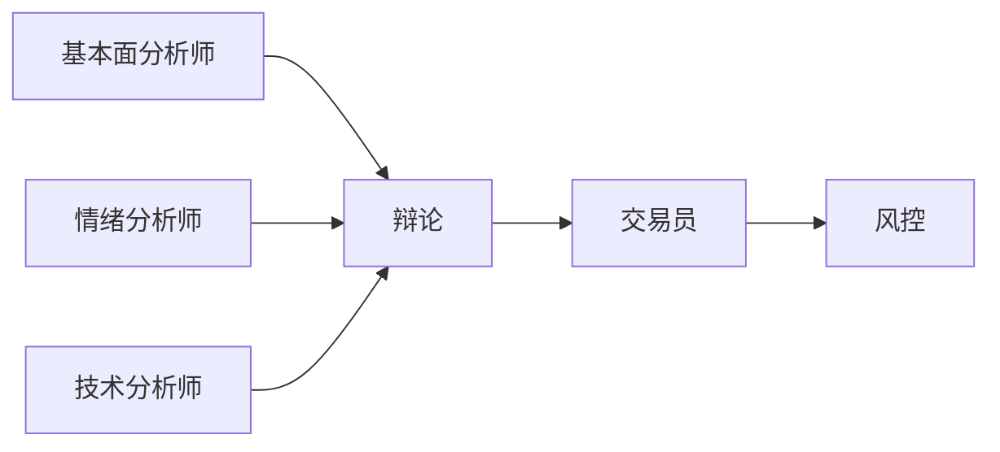
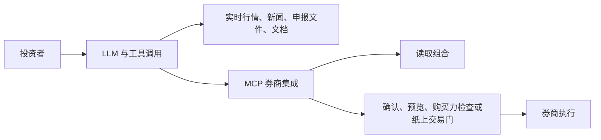

# 报告：TASK-12 个人投资领域的 AI agents

研究：research · web

> [!IMPORTANT]
> **AI 可用于投研；持续跑赢市场尚未得到证明。** (medium)
>
> - 组合分析、选股筛选、财报与新闻摘要已可用。
> - 2026 年推出的真钱交易 agents 均设有执行护栏。
> - 未经审计的选股收益仍属营销说法。
>
> 下一步：先用 Ask IBKR，以及通过 Parqet 连接持仓的助手。
>
> 风险：语气自信的金融错误可能造成真钱损失。

## 产品对比

- 综合判断：沿用原报告的成熟度评价。
- 末列保留原报告置信度及其证据说明。

| 产品 | 定位 | 成熟度 | 原报告置信度与证据 |
|---|---|---|---|
| Robinhood Agentic Trading | 券商执行 | ⚠️ 新兴；隔离子账户 | 高（已核实）；2026-05 上线 |
| Scalable Capital | 券商执行 | ⚠️ 新兴；明确确认 | 高（已核实）；2026-08 上线 |
| Public AI agents | 券商执行 | ⚠️ 新兴；预设指令 | 高（已核实）；2026 年上线 |
| moomoo API Skills | 券商执行 | ⚠️ 默认纸上交易 | 高（已核实）；2026-04 官宣，Q1 财报确认上线 |
| Ask IBKR | 组合投研 | ✅ 成熟；账户内免费 | 高（已核实）；2025-10 上线 |
| eToro Tori | 券商助手 | ⚠️ 新兴；索引证据 | 中（索引）；2026-07 发布 |
| Alpaca | 券商基础设施 | ⚠️ 持续发展 | 高（已核实）；合作券商基础设施 |
| Danelfin | 量化筛选 | ✅ 成熟 | 高（官方页已核实）；Plus $12–25/月 |
| Trade Ideas | 信号与扫描 | ✅ 成熟；活跃交易者 | 高（官方页已核实）；年付折合 $89–178/月 |
| PortfolioPilot | 组合分析 | ✅ 可用 | 高（官方页已核实）；Gold $20–29/月 |
| Magnifi | 对话式投顾 | ✅ 可用 | 中高（官方应用商店描述）；Premium $8.25–14/月 |
| Intellectia AI | 投研信号 | ⚠️ 收益未验证 | 中高（多源一致）；可用 |
| TrendSpider | 技术分析 | ✅ 可用；无免费版 | 中高（多源一致） |
| Tickeron | 交易机器人 | ⚠️ 营销口径重 | 中（多源一致）；可用 |
| Composer by SoFi | 规则自动化 | ✅ 2026-06 被收购 | 高（官方新闻稿与定价页） |
| Autopilot | 复制交易 | ⚠️ 可用；有投诉 | 中（次级信源） |
| Assistants + Parqet | 组合助手 | ✅ 可用；实用首选 | 高（已核实）；约 $20/月 + Parqet 免费档 |
| TradingAgents 及同类 | 开源框架 | ⚠️ 研究；纸上交易 | 高（已核实为研究性质）；免费，token 费用自理 |

- 图例：✅ 可用或成熟；⚠️ 新兴、有限制或存在争议。

## 研究发现

研究发现（8 部分）

### 范围与证据

**本次只改写历史报告，不开展新研究。**

- Artificial intelligence（AI）工具分为四类。 (high)
- 四类：券商执行、专用投研、开源框架、通用助手与连接器。 (high)
- 研究日期：2026-09-27，Coordinated Universal Time（UTC）。 (high)
- 第一轮扫描四个大类、几十个产品。 (high)
- 第二轮独立核验价格，补齐第一轮覆盖缺口。 (high)
- 原文“已核实”：打开过原文页面。 (high)
- 原文“索引”：仅有搜索引擎索引片段。 (high)
- 原置信度高、中、低，对应 high、medium、low。 (high)
- 原中高置信度在改版中归为 medium；下文同时保留原等级。 (high)
- 原文未评级的说法标为 medium，并加 unverified。 (high)
- 结论与价格均截至研究日。 (high)
- 券商、投研产品两组原始底稿：2026-09-27 阅读。 (high)
- 开源与技术、风险与监管两组底稿：2026-09-27 阅读。 (high)
- 另有第二轮价格核验、覆盖缺口补齐两份底稿。 (high)

### 券商 agents

**交易执行正在落地；各券商的护栏不同。**

#### Robinhood Agentic Trading

- Agentic Trading + Agentic Credit Card：2026-05-27。 (high; [1][2])
- Claude/ChatGPT 经 Model Context Protocol（MCP）接入。 (high; [1][2])
- 在与主组合隔离的子账户下单。 (high; [1][2])
- agent 可查看完整组合。 (high; [1][2])
- 用例包括行业配置漂移后的自动再平衡。 (high; [1][2])
- 可逐笔审批，也可授权在限额内执行。 (high; [1][2])
- 价格：券商账户；原表置信度高，已核实。 (high; [1][2])
- 已核实来源日期：2026-06-02、2026-08-31。 (high; [1][2])

均值回归策略用例可包含回测；这是功能描述，原报告未列实盘收益。 (high; [1][2])

#### Scalable Capital Agentic Investing

- 德国上线日期：2026-08-25；已核实全文。 (high; [2])
- 欧洲首家向外部 AI 开放真钱账户的银行。 (high; [2])
- 经 MCP 分析组合、对比基准。 (high; [2])
- agents 可计算定投计划。 (high; [2])
- 可用自然语言调整限价单。 (high; [2])
- 每笔交易与定投计划均需用户明确确认。 (high; [2])
- 出入金只能在 Scalable 自家 App 操作。 (high; [2])
- 价格：券商账户；原表置信度高，已核实。 (high; [2])

#### Public AI agents

- 美国上线时间：2026 年；已核实全文。 (high; [2])
- 原文称其为美国首家推出投资 agent 的券商。 (high; [2])
- standing instructions 自动执行交易、调现金、管理风险。 (high; [2])
- Claude Desktop 经 MCP 直连真实经纪账户。 (high; [2])
- 覆盖股票、exchange-traded funds（ETF）、期权、加密资产。 (high; [2])
- 价格：券商账户；原表置信度高，已核实。 (high; [2])

#### moomoo API Skills

- 官方公告：2026-04-23；已核实完整新闻稿。 (high; [3])
- 个人 agents 直连交易平台，将自然语言意图转为可执行策略。 (high; [3])
- 7×24 监控五个市场。 (high; [3])
- 市场：美国、加拿大、香港、新加坡、日本。 (high; [3])
- 默认纸上交易。 (high; [3])
- OpenD 将凭证保存在本地。 (high; [3])
- 用户保留每笔交易的决定权。 (high; [3])
- Chief Executive Officer（CEO）Neil McDonald 为发布背书。 (high; [3])
- Futu Q1 财报于 2026-05-28 确认全市场上线。 (high; [4])
- 价格：券商账户；原置信度高，已核实。 (high; [3][4][5])

McDonald 预测年底约 20% 交易量由 agents 执行。 (high; [5])

2026-09 报道的是 CEO 预测，并非事实。 (high; [5])

#### Interactive Brokers / Ask IBKR

- Ask IBKR 于 2025-10 上线，账户内免费。 (high; [6][7][2])
- 入口：IBKR Desktop、Client Portal、Advisor Portal。 (high; [6][7][2])
- 作为 PortfolioAnalyst 延伸，回答组合问题。 (high; [6][7][2])
- 示例：相对 S&P 500，哪些行业配置不足。 (high; [6][7][2])
- 2026-06 先后接入 Claude、ChatGPT、Grok。 (high; [6][7][2])
- 免费连接 Grok，可做分析并生成交易指令。 (high; [6][7][2])
- 用途：识别敞口、预测股息、构建对冲。 (high; [6][7][2])

原报告认为其保守、以问答为主，刻意采用非生成式设计。 (high; [6][7][2])

专有确定性方法用于压低幻觉。 (high; [6][7][2])

正文标“索引”，原表标“高（已核实）”，均保留。 (high; [6][7][2])

#### eToro Tori

- 2026-07-07 于伦敦“Intelligence in Motion”发布。 (medium; [8][9])
- Tori 无需用户提问，即主动推送组合洞察。 (medium; [8][9])
- 解释涨跌原因，并提供市场信号。 (medium; [8][9])
- AI-first App 支持 agent 驱动的组合与子账户。 (medium; [8][9])
- 宣布可经 WhatsApp、Apple Watch 使用。 (medium; [8][9])
- eToro Edge 为桌面端；证据来自索引。 (medium; [8][9])
- 价格：券商账户；原置信度中（索引）。 (medium; [8][9])

#### Alpaca

- 2026-07 融资 $135M，由 Peak XV 领投。 (high; [10][11][12])
- 面向合作券商的 MCP server 于 2026-07 公测。 (high; [11])
- 开源 Skills Library 于 2026-08 推出。 (high; [11])
- 回测与纸上交易技能带有 paper-only 安全门。 (high; [11])
- 2026-09 起支持指数期权。 (high; [11])
- 合约：SPX、SPXW、VIX、VIXW。 (high; [11])
- 按 application programming interface（API）计价。 (high; [11])
- 服务券商的基础设施，并非散户自动交易产品。 (high; [11])

Q1 2026 API 用量环比约 4 倍。 (high; [10][11][12])

月增速从 Q4 个位数升至约 30%，原文归因于 AI/agents。 (high; [10][11][12])

正文标“索引”，原表标“高（已核实）”，均保留。 (high; [10][11][12])

综合观察：moomoo 是持牌券商亲自做 agent 接入的标杆。 (high; [3][4])

Robinhood、Scalable、Public 经 MCP 开放第三方。 (high; [2])

Alpaca 提供底层基础设施。 (high; [11])

### 专用投资产品

**投研工具已可用；收益宣传仍需审视。**

#### Danelfin

- 美欧全股票每日 AI Score：1–10。 (high; [13])
- 技术、基本面、情绪子分透明。 (high; [13])
- Free：$0。 (high; [13])
- Plus：月付 $25/月；年付折合 $12/月。 (high; [13])
- Pro：月付 $70/月；年付折合 $35/月。 (high; [13])
- 首 3 个月优惠 50%，即 5 折。 (high; [13])
- 明确不退款；已打开官方定价页。 (high; [13])

Danelfin 公布可审计的分档回测。 (high; [13])

高分组在多个回测窗口跑赢 S&P。 (high; [13])

原报告评为散户中证据最干净的筛选器；成熟，高置信度。 (high; [13])

#### Trade Ideas

- Holly AI 为第一代，Money Machine 为第二代。 (high; [14])
- 工具：实时扫描、OddsMaker 回测、Smart Risk Levels。 (high; [14])
- 自动交易连接 Interactive Brokers。 (high; [14])
- 另接 E*TRADE、Alpaca、moomoo、TradeStation。 (high; [14])
- Tester 免费，使用延迟数据。 (high; [14])
- Standard / “The Core”：$1,068/年，约 $89/月。 (high; [14])
- Premium / “The Apex”：$2,136/年，约 $178/月。 (high; [14])
- 评测称 Blue Bundle/Powder Elite；档名以官方为准。 (medium; [14])

原报告认为该老牌信号与扫描平台成熟，适合活跃交易者。 (high; [14])

年付折合 $89–178/月；高置信度，官方价格页已核实。 (high; [14])

#### PortfolioPilot

- 只给建议，不执行下单。 (high; [15])
- 分析配置、分散度、风险，并做税务优化。 (high; [15])
- 包含遗产规划与净值跟踪。 (high; [15])
- Free：$0；免费试用 10 天。 (high; [15])
- Gold：月付 $29/月；年付 $20/月；最受欢迎。 (high; [15])
- Platinum：月付 $99/月；年付 $49/月。 (high; [15])
- Pro：月付 $149/月；年付 $99/月。 (high; [15])

原报告认为其建议型结构更安全，可用，适合作第二意见。 (high; [15])

Gold $20–29/月；高置信度，官方价格页已核实。 (high; [15])

#### Magnifi

- 对话式建议涵盖目标规划与股票比较。 (medium; [16])
- 组合分析连接 Robinhood、E*TRADE、Schwab。 (medium; [16])
- 支持站内免佣下单。 (medium; [16])
- 有免费档；Premium 月付 $14/月。 (medium; [16])
- Premium 年付折合 $8.25/月，约 $99/年。 (medium; [16])
- Managed Portfolios 另加 0.23%/年。 (medium; [16])

原置信度中高：官方发布者描述，多商店镜像一致。 (medium; [16])

WallStreetZen 报 $132/年，或为近期调价；取发布者自述。 (medium; [16][17])

原报告评为可用的老牌助手，确实连券商、可站内执行。 (medium; [16])

#### Intellectia AI

- 每日盘前选股于美国 Eastern Time（ET）8:00 AM 推送。 (medium; [18])
- 含波段信号、对话式 agent。 (medium; [18])
- 跟踪国会交易、对冲基金持仓。 (medium; [18])
- 包含 100+ 技术指标。 (medium; [18])
- 数据含 OpenAI、New York Stock Exchange（NYSE）数据。 (medium; [18])
- 另含 Refinitiv/LSEG、TradingView、Polygon.io。 (medium; [18][19])
- 2023 年由 Fei Chen、Tony Tong 创立。 (medium; [18])
- Fei Chen 为 CEO。 (medium; [18])
- Tony Tong 为 Chief Technology Officer（CTO）。 (medium; [18])
- Free：5 prompts。 (medium; [18])
- Basic：月付 $14.95/月；年付 $11.96/月。 (medium; [18])
- Pro 年付：$23.96/月。 (medium; [18])
- Max 年付：$39.96/月。 (medium; [18])
- Expert 年付：$71.96/月。 (medium; [18])
- $1 试用 7 天；iOS 评分 4.8/5。 (medium; [18])

原置信度中高（多源一致）；官方价格页 JavaScript 未渲染。 (medium; [18])

价格来自 5+ 一致次级信源，定价置信度中高。 (medium; [18])

收益数字均为回测或用户自述，未验证。 (medium; [18]; unverified)

官方评测也附 disclaimer；原报告按营销处理。 (medium; [18]; unverified)

#### TrendSpider

- 自动识别趋势线、形态，并支持自然语言扫描。 (medium; [20])
- 提供无代码回测、交易机器人。 (medium; [20])
- 所有档的 Sidekick 每月仅含 25 条免费消息。 (medium; [20])
- 超量 add-on：$49/$129/$349。 (medium; [20])
- 2026-08 新增可选模型 Claude Opus 5。 (medium; [20])

| 套餐 | 按月付 | 按年付，折合每月 |
|---|---|---|
| Standard | $82/月 | 约 $54/月 |
| Premium | $137/月 | 约 $91/月 |
| Enhanced | $183/月 | 约 $122/月 |
| Advanced | $321/月 | 约 $214/月 |

- 上表价格来自 4+ 一致独立信源；原置信度中高。 (medium; [20])
- 无免费版；14 天试用收费 $19–49。 (medium; [20])

#### Tickeron

- AI Trading Robots：Signal、Virtual、Brokerage 三类。 (medium; [21])
- 工具含形态搜索、自研 FLM 趋势预测。 (medium; [21])
- Double Agents 做多空配对；Time Machine 用于回测。 (medium; [21])
- Beginner 免费；付费档约 $50–250/月。 (medium; [21])
- Intermediate One：约 $50–100/月。 (medium; [21])
- Intermediate Two：约 $120–210/月。 (medium; [21])
- Expert：$250/月；模块化 add-on：$20–40/月。 (medium; [21])
- 多家评测称定价结构混乱；多源一致，原置信度中。 (medium; [21])

机器人自称回报 150%–360%。 (medium; [21]; unverified)

Double Agents 回测年化 169%–270%。 (medium; [21]; unverified)

均无独立审计；原报告认为不可采信，属营销。 (medium; [21]; unverified)

#### Composer by SoFi

- 自然语言构建可回测、可执行的规则策略。 (high; [22][23])
- 含 2000+ 社区策略。 (high; [22][23])
- SoFi 宣布收购 Composer Securities LLC。 (high; [22])
- 公告日期 2026-06-23；CEO Anthony Noto 背书。 (high; [22])
- 计划整合至 SoFi Plus，面向 1470 万会员推广。 (high; [22])
- Starter：$0；Advanced：$10/月。 (high; [23])
- Pro：$32/月、$384/年；Business 定制。 (high; [23])
- 已打开官方新闻稿与官方定价页；原置信度高。 (high; [22][23])

SoFi 强调 AI 构建规则策略，并非持续自主做交易决策。 (high; [22])

原报告据此认为，其风险面比全自主交易 agent 小。 (high; [22])

#### Autopilot

- 镜像政客的 STOCK Act 披露。 (medium; [24])
- 也复制对冲基金 13F 与实时交易员组合。 (medium; [24])
- Autopilot Advisers, LLC 为注册投顾。 (medium; [24])
- 监管方：Securities and Exchange Commission（SEC）。 (medium; [24])
- 成立于 2019–2020 年。 (medium; [24])
- 免费版无自动跟单。 (medium; [24])
- 付费约 $100/年/组合，或 $29/3 个月。 (medium; [24])
- 每组合最低 $500；次级信源一致，原定价置信度中。 (medium; [24])

聚合投诉涉及隐藏费用、执行延迟最长 45 天。 (medium; [24])

还有提现、取消困难；原投诉置信度中。 (medium; [24])

官方宣传 3M+ 用户、$1B+ 已投。 (medium; [24]; unverified)

2025 年初为 700k 用户、$150M。 (medium; [24]; unverified)

原报告质疑短期约 4 倍增长；数字未验证。 (medium; [24]; unverified)

#### Kavout 与 AltIndex

- Kavout：神经网络 Kai Score，1–9。 (medium; [25]; single-source)
- Kavout 数据从 SEC 文件到卫星图像。 (medium; [25]; single-source)
- 2026 年“Most Agreed”按模型共识选股。 (medium; [25]; single-source)
- AltIndex 用社媒情绪，含 TikTok。 (medium; [25]; single-source)
- 数据另含招聘、App 下载、信用卡交易。 (medium; [25]; single-source)

AltIndex 寻求财报前的信息差。 (medium; [25]; single-source)

两者仅有索引，来自同篇 HowStuffWorks 营销文章。
(medium; [25]; single-source)

Kavout“大幅跑赢 S&P”的说法未验证。 (medium; [25]; unverified)

原报告认为数据思路有意思，业绩宣传属营销。 (medium; [25]; unverified)

#### Parqet

- 组合跟踪器；2026-04 起提供官方 AI 连接器。 (high; [26])
- 一次连接，将持仓接给 ChatGPT/Claude/Perplexity。 (high; [26])
- 问题涵盖集中度风险、股息日历。 (high; [26])
- 也支持 year-to-date（YTD）归因、行业配置。 (high; [26])
- Parqet 免费档可搭配约 $20/月的助手。 (high; [26])
- 官方博客已打开，发布日期 2026-05-29。 (high; [26])
- 持仓数据经过 AI 厂商服务器。 (high; [26])
- Parqet 称只传问题相关数据。 (high; [26])
- 其称不会传姓名或登录信息。 (high; [26])

连接器补上助手不知道真实持仓的缺口。 (high; [26])

原报告评为当前最实用组合，可用；高置信度，已核实。 (high; [26])

AI 解读仍可能出现幻觉。 (high; [26])

#### Paramount AI / Invest AI

自称 autonomous trading engine。 (medium; [27]; single-source)

声称“outperform 95% of market products”，未验证。
(medium; [27]; unverified)

仅有 AB Newswire 付费稿索引，引用内部基准。 (medium; [27]; single-source)

原报告按营销炒作处理。 (medium; [27]; single-source)

### 开源 agents

**适合学习研究；经审计的持续实盘超额证据为零。**

- LLM：large language model。 (high)
- 研究性质的原置信度高，已核实为研究工具。 (high)
- 框架免费，model tokens 费用自理。 (high)

#### TradingAgents / TauricResearch

- LangGraph 编排模拟交易公司的多 agent LLM 框架。 (medium; unverified)

- 2026 年版本系列：v0.2.x。 (medium; unverified)
- 模型：GPT-5.x、Gemini 3.x、Claude 4.x、Grok 4.x。 (medium; unverified)
- 另支持 DeepSeek、Qwen、GLM。 (medium; unverified)
- GitHub stars：约 80–93k。 (medium; unverified)

项目声明“for research, not financial advice”。 (high; unverified)

原报告认定为研究工具，无经审计实盘超额证据。 (high; unverified)

只建议纸上运行。 (high; unverified)

#### 其他框架与数据层

- ai-hedge-fund / virattt：14 个传奇投资人 personas。 (medium; unverified)
- Buffett、Munger、Burry 与分析 agents 辩论选股。 (medium; unverified)
- ai-hedge-fund：约 60k stars，研究与教育性质。 (high; unverified)
- FinRL 使用 deep reinforcement learning。 (medium; unverified)
- FinRL-Trading 增加 Alpaca 实盘层，约 15.7k stars。 (medium; unverified)
- FinRL-Trading 部署层偏生产向。 (medium; unverified)
- OpenBB：开源数据平台与研究终端。 (medium; unverified)
- OpenBB 统一股票、期权、加密与宏观数据。 (medium; unverified)
- OpenBB：约 70.5k stars，免费 agent 数据层。 (medium; unverified)
- HKUDS Vibe-Trading：自然语言 agents，约 20.9k stars。 (medium; unverified)
- HKUDS AI-Trader：agent-native 平台，约 20.8k stars。 (medium; unverified)
- FinRobot 用 LLM agents 自动生成 equity research 报告。 (medium; unverified)
- FinGPT：金融 LLM 与情绪管线，约 20.9k stars。 (medium; unverified)

这些框架适合学习研究，无经审计的持续实盘超额证据。 (high; unverified)

原报告对“研究工具”的判断给高置信度。 (high; unverified)

#### Options Alpha Agent 实例

- Alpaca AI Trading Agents Hackathon：2026-08-28–09-04。 (medium; unverified)
- IV：implied volatility；RV：realized volatility。 (medium; unverified)
- 在 IV/RV 状态间切换。 (medium; unverified)
- 使用 defined-risk vertical spreads。 (medium; unverified)
- 使用官方 command-line interface（CLI）。 (medium; unverified)

该实例为 $100k 纸上账户。 (medium; unverified)

作者承认没有方向性 edge。 (medium; unverified)

### 通用助手

**结合真实持仓与文档做分析，是实用用途。**

#### ChatGPT

- 美国 finance 界面于 2026-05 上线。 (high; [26])
- 可连接账户与券商组合；已核实。 (high; [26])

Morningstar/MarketWatch 于 2025-12 做选股测试。 (medium; [28])

参与者：ChatGPT、Claude、Gemini、Grok。 (medium; [28])

要求给出 2026 年具体股票配置。 (medium; [28])

原报告视为“AI 选股师”炒作样本，答案仅供娱乐。 (medium; [28])

#### Perplexity

- Finance 页提供实时行情与带引用的回答。 (medium; unverified)
- Perplexity Computer 于 2026-02 推出多步任务。 (medium; unverified)
- Pro：$20/月，可路由 Claude、GPT-5.6、Gemini。 (medium; unverified)

#### Claude

- 分析 10-K 与财报 PDF 等长文档。 (medium; unverified)
- 支持推理、自定义筛选器与回测代码。 (medium; unverified)
- Claude Desktop 经 MCP 直连 Public、Scalable Capital。 (high; [2])
- 券商账户连接已核实；另见“券商 agents”。 (high; [2])

#### Meta Muse

- 2026-09-08 发布，5 天约 60 万下载。 (medium; unverified)
- 索引证据显示可浏览网站、完成多步任务。 (medium; unverified)
- 属通用消费级 agent，无投研专属功能。 (medium; unverified)

### 技术架构

**工具调用连接模型、数据与带护栏的执行。**

- agents 靠工具行动，并非只凭模型权重交易。 (medium; unverified)
- 原报告将 MCP 视为 2026 年事实标准集成层。 (high; [2][11][3])
- 总览也将 IBKR、eToro 列入 MCP 收敛趋势。 (medium; unverified)
- Robinhood、Scalable、Public、moomoo 开放工作流。 (high; [2][3])
- Alpaca Trading API 用 REST 与订单、账户流式更新。 (medium; [11])
- Alpaca 以纸上交易环境作为安全门。 (high; [11])
- IBKR 工具：Flex queries、Client Portal。 (medium; unverified)
- “Configure Flex with AI”用自然语言构建报表。 (medium; unverified)
- 输入包括行情、SEC 文件、新闻 wires。 (medium; unverified)
- 行情供应商见 Intellectia AI。 (medium; [18][19])
- 另类数据输入见 AltIndex。 (medium; [25]; single-source)
- Retrieval-augmented generation（RAG）接入实时数据。 (medium; unverified)
- 不应信任训练数据里的价格。 (medium; unverified)
- 多模型交叉验证也是防幻觉手段。 (medium; unverified)
- human-in-the-loop 门包含订单预览与购买力检查。 (medium; unverified)
- Alpaca Backtesting Skill 将策略形式化。 (high; [11])
- 该 skill 跟踪假设并生成可复现报告。 (high; [11])
- 回测引擎包括 backtrader、QuantConnect Lean。 (medium; unverified)

### 局限与风险

**金融错误、执行摩擦与不确定性仍然存在。**

#### Saturn Artificial Authority 基准

2026-09-21 发布；完整次级报道已核实。 (high; [1])

18 个模型、121 道理财题，5 轮，10,000+ 回答。 (high; [1])

平均准确率 43%，错误或不完整占 57%。 (high; [1])

难题准确率仅 12%，包括交互税法；精确数字也容易出错。 (high; [1])

最佳为 Claude Opus 5（reasoning），整体仍约错 40%。 (high; [1])

其难题错误率 67%。 (high; [1])

错误中 6.1% 为编造规则，2.3% 为使用过时法规。 (high; [1])

错误与正确答案的语气同样自信。 (high; [1])

免费模型失败率 63%，付费模型 49%。 (high; [1])

最请不起投顾的人，反而得到更差的免费建议。 (high; [1])

#### 延迟、成本与实盘交易

reasoning 响应需 3–5 秒，辩论会增加延迟。 (medium; unverified)

日度投研可容忍，日内执行时机受影响。 (medium; unverified)

实盘风控与路由需 LLM 之外的确定性代码。 (medium; unverified)

订阅叠加：Intellectia $11.96/月、Danelfin $12–25/月。 (medium; [18][13])

PortfolioPilot $20–29/月、Magnifi $8.25–14/月。 (medium; [15][16])

原报告中 ChatGPT/Perplexity 约 $20/月。 (medium; unverified)

开源免费，但多 agent 的 tokens 贵，另加行情费。 (medium; unverified)

一次 TradingAgents 实盘运行 30 天，收益 +7%。 (medium; unverified)

同期 S&P 500 +4.5%；该实盘回撤 22%。 (medium; unverified)

结果不可重复。 (medium; unverified)

费用、滑点、市场机制变化会侵蚀回测收益。 (medium; unverified)

隔离账户、明确确认、paper-only 门反映真钱自主交易的高风险。
(medium; unverified)

大量 agents 使用相同信号，可能放大波动。 (medium; unverified)

责任归属、披露未解决；持仓隐私见 Parqet。 (medium; unverified)

#### 监管

- 未发现 AI-agent 专属规则。 (medium; unverified)
- SEC 2026 Exam Priorities 审查 AI 能力表述的准确性。 (medium; [29])
- 同时审查交易环节对 AI 的监督。 (medium; [29])
- FINRA：Financial Industry Regulatory Authority。 (medium; [30])
- Notice 24-09 将规则视为技术中性。 (medium; [30])
- 券商仍对 AI 输出负全责。 (medium; [30])
- 责任覆盖监督、适当性、通信。 (medium; [30])
- Regulation Best Interest（Reg BI）、留痕要求同样适用。 (medium; [30])
- NASAA：North American Securities Administrators Association。 (medium; [31])
- 2026-09，NASAA 敦促 FINRA 收紧 AI 内容监管。 (medium; [31])
- 散户自主 agents 的出现早于专门规则。 (medium; [29][30][31]; unverified)

#### 未验证的营销数字

“Q1 2026 因幻觉损失 $2.3B”的说法未验证。
(medium; [32]; unverified)

该数字仅有一个薄弱的 LinkedIn 来源。 (medium; [32]; single-source)

回报宣传及证据限制见各产品小节。 (medium; [18][21][25][27]; unverified)

### 实用选择

**先做分析；自主执行只用小资金。**

成熟与可用判断、价格、效果证据、置信度见产品对比及各小节。

新兴执行产品见“券商 agents”。

原文称其“都不到 4 个月”，与部分 4 月、5 月日期矛盾。
(medium; unverified)

- 综合建议：用免费或便宜的 Ask IBKR 与持仓连接助手。 (medium; [2][26])
- Ask IBKR 是原报告首选的组合问答工具。 (high; [2])
- Danelfin 是原报告首选的量化筛选器。 (high; [13])
- PortfolioPilot 可提供第二意见。 (high; [15])
- 下单走 Robinhood/Scalable/Public/moomoo 官方通道。 (high; [2][3])
- 实盘配置保持小额，启用逐笔确认。 (medium; [2][3])
- 开源框架仅用纸上账户。 (high; unverified)
- 大资金入场前，先等事故报告。 (medium; unverified)

## 已知说法的修正

- Danelfin：第一轮“Starter 约 $27/月”有误，官方无 Starter。 [13]
- 入门为 Plus：月付 $25/月、年付 $12/月；其余价格见产品小节。 [13]
- Magnifi：“最高约 $168/年”是月付价格 ×12；应看年付约 $99。 [16]
- moomoo：单一弱来源升级为三重印证，见对应产品。 [3][4][5]
- Composer：第一轮遗漏；补入 2026-06-23 收购及新品牌。 [22][23]
- Trade Ideas/PortfolioPilot Gold：第二轮已打开官方价格页。 [14][15]
- Autopilot/TrendSpider/Tickeron：第二轮补齐，并限定营销说法。 [24][20][21]

## 证据缺口

- 可能改变结论：新 agents 仅有几周至几个月实盘历史，无独立审计。
- 可能改变结论：持续实盘跑赢市场仍未证明。
- 可能改变结论：原报告许多发现没有公开支持链接。
- 不改变结论：原文“不到 4 个月”的日期矛盾，见“实用选择”。
- 不改变结论：Intellectia 价格依赖 5+ 次级信源，原置信度中高。
- 不改变结论：Magnifi 缺官方价格页，采用官方应用商店描述。
- 不改变结论：TrendSpider/Tickeron/Autopilot 官方价格页未打开。
- 这三者采用一致的次级价格，原缺口说明给中置信度。
- TrendSpider 的详细定价说明则给中高置信度，两者均保留。
- 不改变结论：Kavout/Paramount 业绩与 $2.3B 数字仍未验证。
- 不改变结论：部分来源链接仅到域名，四个定价链接夹有编码文字。
- 来源链接原样保留，不修复，不做新研究。
- 缺失链接只保留具名来源，不编造链接。

## 来源

来源（32 项）

1. [Wealth Professional: Robinhood, Jun 2; Saturn, Sep 21](<http://wealthprofessional.ca>)（次级）
2. [PYMNTS: Retail Investing Opens Up to AI Assistants, Aug 31](<http://pymnts.com>)（次级）
3. GlobeNewswire: moomoo API Skills release, Apr 23（一级）
4. Futu: Q1 results, May 28（一级）
5. Wall Street Journal: McDonald forecast, Sep 2026（次级）
6. [CryptoNWZ: Interactive Brokers](<http://cryptonwz.com>)（次级）
7. [Good Money Guide: Interactive Brokers](<http://goodmoneyguide.com>)（次级）
8. [StockTitan: eToro launch](<http://stocktitan.net>)（次级）
9. GlobeNewswire: eToro launch, Jul 7（一级）
10. [Pulse 2.0: Alpaca funding](<http://pulse2.com>)（次级）
11. [Alpaca official blog](<http://alpaca.markets>)（一级）
12. [WalletInvestor: Alpaca](<http://walletinvestor.com>)（次级）
13. [Danelfin pricing](<http://danelfin.com/pricing%EF%BC%8C%E4%BB%8A%E6%97%A5%E7%9B%B4%E8%BF%9E%E5%B7%B2%E6%A0%B8%E5%AE%9E%EF%BC%89%EF%BC%9AFree>)（一级）
14. [Trade Ideas official forum pricing](<http://forums.trade-ideas.com/pricing%EF%BC%8C%E5%B7%B2%E6%A0%B8%E5%AE%9E%EF%BC%89%EF%BC%9ATester>)（一级）
15. [PortfolioPilot pricing](<http://portfoliopilot.com/pricing%EF%BC%8C%E5%B7%B2%E6%A0%B8%E5%AE%9E%EF%BC%89%EF%BC%9AFree>)（一级）
16. Magnifi: Google Play publisher text; store mirrors（一级）
17. WallStreetZen: Magnifi pricing（次级）
18. Intellectia AI: 5+ unnamed agreeing sources（次级）
19. [Polygon.io data provider](<http://Polygon.io>)（一级）
20. TrendSpider: 4+ unnamed independent sources（次级）
21. Tickeron: unnamed agreeing reviews（次级）
22. SoFi: Composer acquisition, Jun 23; via Morningstar（一级）
23. [Composer pricing](<http://composer.trade/pricing%EF%BC%89%EF%BC%9AStarter>)（一级）
24. Autopilot: unnamed secondary sources and complaints（次级）
25. HowStuffWorks: Kavout and AltIndex article（次级）
26. [Parqet: AI Stock Analysis, May 29](<http://parqet.com>)（一级）
27. AB Newswire: Paramount AI paid press release（一级）
28. Morningstar/MarketWatch: 2026 stock picks, Dec 2025（次级）
29. Securities and Exchange Commission: 2026 Exam Priorities（一级）
30. Financial Industry Regulatory Authority: Notice 24-09（一级）
31. North American Securities Administrators Association, Sep 2026（一级）
32. LinkedIn: single hallucination-loss claim（次级）

